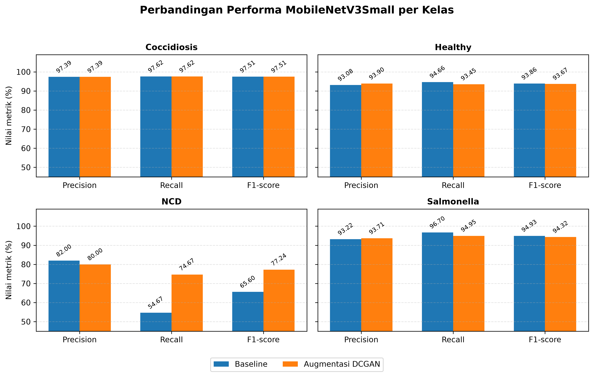
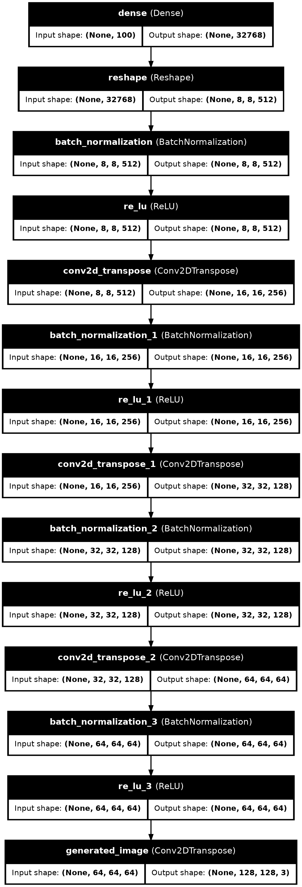

# 🐔 PoultryVision: Klasifikasi Penyakit Ayam Berbasis Citra Feses Menggunakan MobileNetV3 dengan Augmentasi DCGAN

[](https://python.org)
[](https://tensorflow.org)
[](https://streamlit.io)
[](https://zenodo.org/records/4628934)
[](LICENSE)

> 🎓 **Skripsi / Tugas Akhir** — Program Studi Teknik Informatika, Universitas Komputer Indonesia (UNIKOM), 2026  
> 🔬 **Topik:** *Computer Vision, Generative Adversarial Networks (GANs), Transfer Learning, Class Imbalance Handling*

---

## 📌 Sumber & Akses Dataset (Zenodo)

> [!NOTE]  
> **Informasi Dataset:**  
> Repository ini **hanya menyertakan source code, notebook analisis, dashboard, dan pre-trained model**, tanpa menyertakan dataset gambar secara langsung untuk menjaga ukuran repository tetap efisien.  
> 
> Penelitian ini menggunakan **dataset sekunder publik** yang dapat diunduh secara resmi melalui Zenodo:  
> 🔗 **[Machine Learning Dataset for Poultry Diseases Diagnostics | Zenodo](https://zenodo.org/records/4628934)**  
> *(Citra kotoran ayam yang terdiri dari 4 kelas: Coccidiosis, Healthy, Newcastle Disease, dan Salmonellosis)*.

---

## 🌟 Highlight & Ringkasan Penelitian

Penelitian ini memecahkan permasalahan **ketimpangan kelas (*class imbalance*)** ekstrem dalam diagnosis penyakit unggas berbasis citra kotoran (*fecal images*). Pada dataset asli, kelas **NCD (Newcastle Disease)** hanya mencakup **5.5%** dari total data, menyebabkan model baseline mengalami bias dan performa recall yang rendah pada kelas kritis tersebut.

### 💡 Solusi yang Diterapkan:
1. **Generasi Citra Sintetis NCD**: Menggunakan arsitektur **DCGAN (Deep Convolutional GAN)** untuk menghasilkan **1.520 citra feses sintetis berkualitas tinggi** khusus kelas NCD.
2. **Transfer Learning Efisien**: Memanfaatkan **MobileNetV3-Small** yang ringan, cepat, dan cocok diimplementasikan pada perangkat *edge* / mobile peternak.
3. **Peningkatan Performa Nyata**:
   - 🚀 **Recall NCD melonjak drastis dari 54.67% ➔ 74.67% (+20.00%)**
   - 📈 **F1-Score NCD meningkat dari 65.60% ➔ 77.24% (+11.64%)**
   - 🎯 **Macro Average F1 meningkat dari 87.98% ➔ 90.69%**
4. **Interactive Web Dashboard**: Aplikasi inferensi berbasis **Streamlit** dengan fitur perbandingan inferensi *side-by-side* antara Model Baseline dan Model DCGAN secara real-time.

---

## 📊 Hasil Evaluasi & Perbandingan Model

Evaluasi dilakukan pada *test set* independen sebanyak **1.363 citra**.

| Kelas Penyakit | Model Baseline (Tanpa DCGAN)<br>Precision / Recall / F1-Score | Model DCGAN (Dengan Augmentasi)<br>Precision / Recall / F1-Score | Peningkatan Recall NCD |
| :--- | :---: | :---: | :---: |
| **Healthy** | 93.08% / 94.66% / 93.86% | 93.90% / 93.45% / 93.67% | - |
| **Cocci (Koksidiosis)** | 97.39% / 97.62% / 97.51% | 97.39% / 97.62% / 97.51% | - |
| **Salmo (Salmonellosis)** | 93.22% / 96.70% / 94.93% | 93.71% / 94.95% / 94.32% | - |
| **NCD (Newcastle Disease)** ⚠️ | **82.00% / 54.67% / 65.60%** | **80.00% / 74.67% / 77.24%** | **+20.00% (Recall)** |
| **Accuracy Keseluruhan** | **94.06%** | **94.20%** | - |
| **Macro Average F1** | **87.98%** | **90.69%** | **+2.71%** |

### 📈 Visualisasi Perbandingan Performa


---

## 🏗️ Metodologi & Pipeline Sistem

```
┌─────────────────────────────────────────────────────────────────────────────┐
│                             ALUR PENELITIAN                                 │
├─────────────────────────────────────────────────────────────────────────────┤
│                                                                             │
│  [1] Dataset Sekunder Zenodo (6.812 Citra)                                  │
│      ├── Cocci: 2.103 | Healthy: 2.057 | Salmo: 2.276                       │
│      └── NCD: 376 (Imbalanced - 5.5%)                                       │
│                                                                             │
│  [2] DCGAN Balancing Pipeline (Kelas NCD)                                   │
│      ├── Generator & Discriminator Training (Epoch 0 - 600+)                │
│      ├── Evaluasi Kualitas Citra Sintetis (FID: 192.6)                      │
│      └── Generate 1.520 Citra Sintetis NCD                                  │
│                                                                             │
│  [3] Dataset Balanced (8.332 Citra)                                         │
│      └── NCD: 1.896 (376 Asli + 1.520 DCGAN Sintetis)                       │
│                                                                             │
│  [4] Model Training (MobileNetV3-Small)                                     │
│      ├── Model A: Baseline Classifier (Data Asli)                           │
│      └── Model B: Balanced Classifier (Data Asli + DCGAN)                   │
│                                                                             │
│  [5] Deployment & Visualisasi                                               │
│      └── Streamlit Web App (Single Diagnosis & Comparative Mode)            │
└─────────────────────────────────────────────────────────────────────────────┘
```

### 🧠 Arsitektur Generator DCGAN
Citra sintetis NCD beresolusi 128×128 dibangkitkan dari *latent vector* (100-dimensi) melalui lapisan *Conv2DTranspose*, *Batch Normalization*, dan *LeakyReLU*:



---

## 🗂️ Struktur Direktori

```text
├── 📓 Balancing_DCGAN.ipynb          # Eksperimen & training DCGAN kelas NCD
├── 📓 Analysis_DCGAN.ipynb           # Evaluasi kualitas citra sintetis & FID Score
├── 📓 MobileNetV3_Baseline.ipynb     # Pelatihan model MobileNetV3 (data asli)
├── 📓 MobileNetV3_DCGAN.ipynb        # Pelatihan model MobileNetV3 (data augmentasi DCGAN)
├── 🐍 dashboard.py                  # Aplikasi Streamlit (UI interaktif diagnosis)
├── 📄 requirements.txt              # Daftar pustaka & dependensi
├── 📄 .gitignore                    # Konfigurasi file yang diabaikan Git
├── 📊 perbandingan_performa_model.png  # Grafik metrik performa model
├── 📊 generator_model.png           # Diagram arsitektur generator DCGAN
└── 📂 model_outputs/                # Model terlatih (.keras) siap pakai
    ├── MobileNetV3_Baseline/
    │   └── model_baseline_final.keras
    └── MobileNetV3_DCGAN/
        └── model_dcgan_final.keras
```

---

## 🖥️ Interactive Web Dashboard (Streamlit)

Dashboard menyediakan antarmuka modern yang ramah pengguna untuk peternak dan praktisi:
- **Tab 1: Single Prediction (Baseline)** — Menguji citra dengan model baseline.
- **Tab 2: Single Prediction (DCGAN)** — Menguji citra dengan model berbobot seimbang.
- **Tab 3: Perbandingan Model Side-by-Side** — Menampilkan prediksi kedua model secara bersamaan beserta perbandingan distribusi probabilitas kelas (*confidence bar chart*).
- **Rekomendasi Tindakan Cepat** — Memberikan panduan sanitasi, isolasi, atau pengobatan sesuai penyakit yang terdeteksi.

---

## 🚀 Panduan Instalasi & Penggunaan

### 1. Clone Repository
```bash
git clone https://github.com/USERNAME_ANDA/klasifikasi-penyakit-ayam-mobilenetv3-dcgan.git
cd klasifikasi-penyakit-ayam-mobilenetv3-dcgan
```

### 2. Buat Lingkungan Virtual (Opsional namun Disarankan)
```bash
# Windows
python -m venv venv
.\venv\Scripts\activate

# Linux / macOS
python3 -m venv venv
source venv/bin/activate
```

### 3. Install Dependensi
```bash
pip install -r requirements.txt
```

### 4. Menjalankan Dashboard Streamlit
Model `.keras` yang telah terlatih sudah disertakan di folder `model_outputs/`, sehingga dashboard bisa langsung dijalankan tanpa perlu training ulang:
```bash
streamlit run dashboard.py
```
Akses dashboard di browser Anda pada alamat: `http://localhost:8501`.

---
